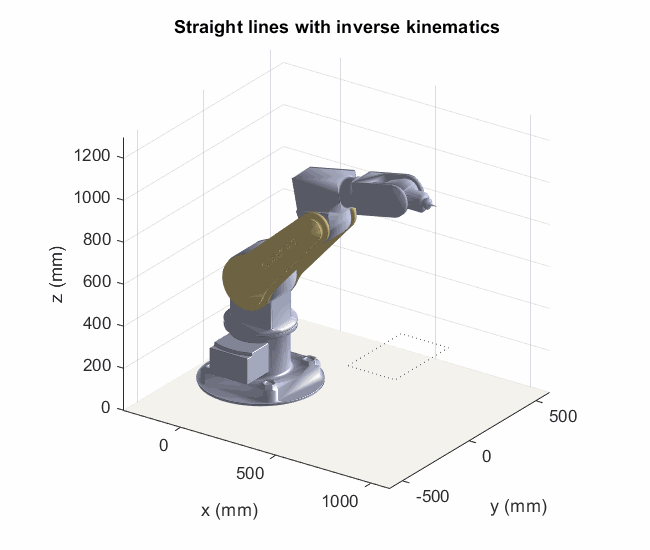
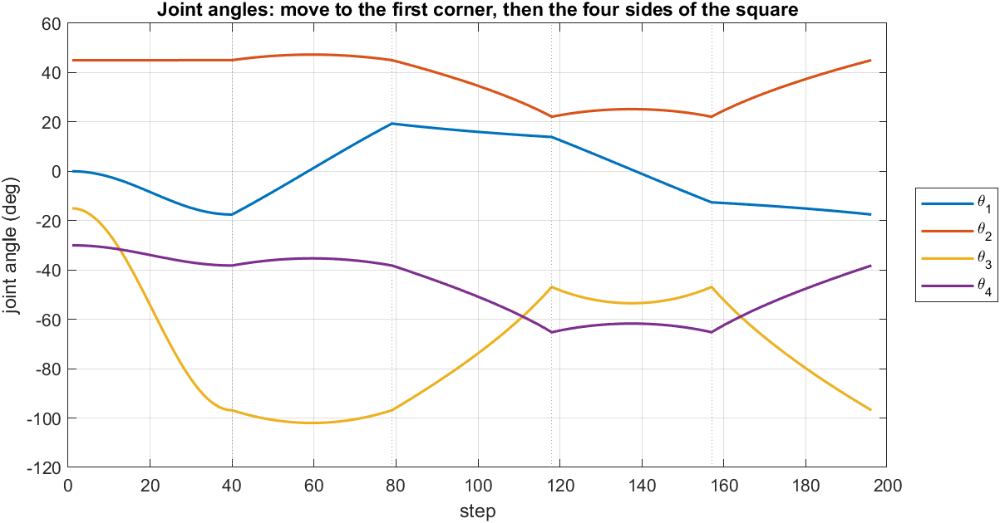
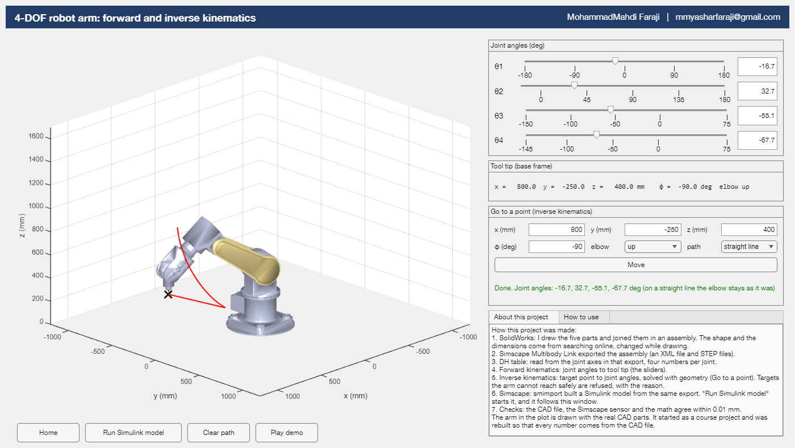
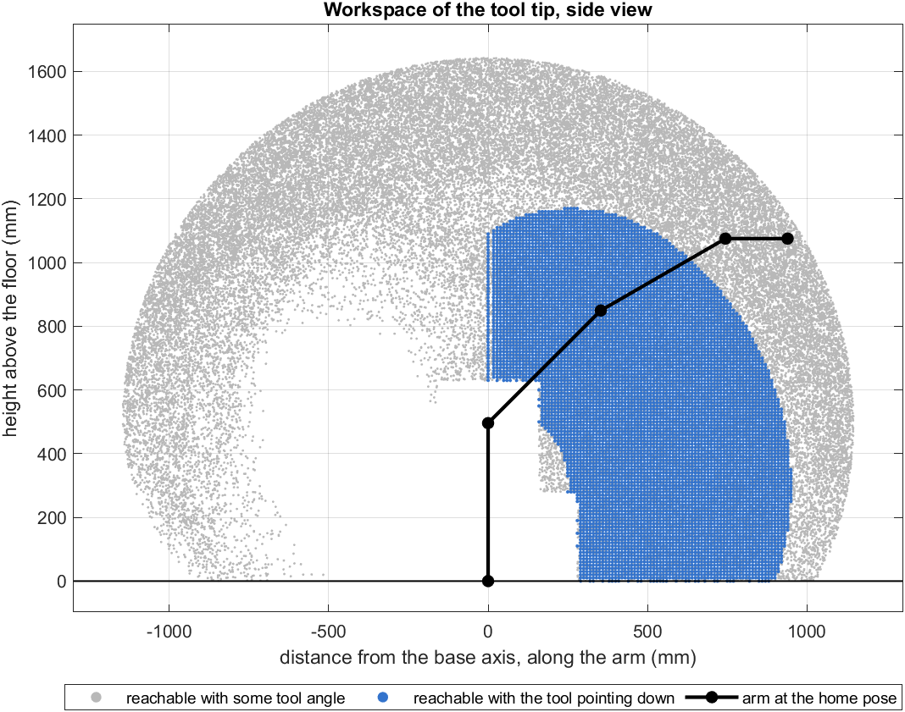

# A 4-DOF robot arm: from a SolidWorks model to forward and inverse kinematics in MATLAB

**Author:** MohammadMahdi Faraji

You give the arm a point in space, for example "30 cm above the table, 80 cm in front of you, tool pointing down", and it works out how far each of its four joints has to turn to put the tool tip there. This repository has the whole chain: the arm modelled in SolidWorks, the math between joint angles and tool position, a Simscape model built from the same CAD files, and a window to move the arm with sliders or by typing a target.

<p align="center"></p>
<p align="center"><sub>The tool tip draws a square on a table while the tool keeps pointing straight down. Every point of every side is solved with inverse kinematics.</sub></p>

## Quick start

Download the repository (Code > Download ZIP), unzip it and double-click **`click_to_fast_start.bat`** (Windows, MATLAB needed). MATLAB starts, and the window of the arm opens with a short demo: the arm goes to a point, then draws the square above. After that you can move it yourself.

On other systems, open `click_to_fast_start.m` in MATLAB and press Run. MATLAB can take a minute to start, and Windows may ask once before it runs a file from the internet.

## What this project is about

A robot arm is a chain of links joined by motors. The motors only know angles: "turn 30 degrees". But the job is almost always described as a place: "put the gripper on that cup". So there are two questions, and they go in opposite directions.

- **Forward kinematics:** if the joints have these angles, where is the tool tip? This one is easy. You walk along the arm link by link, like following directions: "go up 496 mm, turn, go 500 mm forward, turn again...". At the end of the walk you know where you are.
- **Inverse kinematics:** I want the tool tip here, so what angles do I need? This is the hard one. Some points can't be reached at all. Some points can be reached in two ways, like touching your nose with your elbow pointing up or down. And a joint may not be able to turn far enough.

This started as my course project, with the same parts: the CAD model, a Simscape model and a GUI with sliders. When I checked it against the 3D model, the numbers in the math did not match the arm, and the inverse kinematics did not agree with the forward kinematics. I rebuilt it so that every number comes from the CAD file and every part checks the others. [docs/changes_from_course_project.md](docs/changes_from_course_project.md) lists what was wrong in the first version.

The shape and the dimensions of the arm are the result of searching online. I looked at pictures and numbers of different industrial arms and other sources, put them together and changed them while drawing the parts in SolidWorks.

## At a glance

| | |
|---|---|
| Arm | 4 revolute joints: base, shoulder, elbow, wrist |
| Size | shoulder 496 mm above the floor, links 500, 451 and 195 mm |
| Reach | up to 1146 mm from the base axis, up to 1642 mm high |
| CAD | SolidWorks (5 parts, 1 assembly), shape and dimensions from online sources, modified |
| Software | MATLAB R2024b, Simulink, Simscape Multibody, Simscape Multibody Link 7.4 |
| Inverse kinematics | closed form (geometric), tool angle as input, elbow up or down |

## Results

There are three independent ways to find the tool tip, and they agree:

| check | difference |
|---|---:|
| forward kinematics vs the tool tip in the SolidWorks file | 0.007 mm |
| forward kinematics vs the Simscape model (its own sensor), 8 poses | 0.0019 mm |
| inverse kinematics, then forward kinematics again, 20000 random poses | about 1e-12 mm |

The Simscape model is the independent check. It is built only from the CAD export and does not use my DH table, only a sign and an offset per joint to turn my angles into its own. A sensor in the model measures the tool tip, so a mistake of even one millimetre in the table would show up there.

`matlab/check_kinematics.m` runs all the checks, including some impossible targets (too far, inside the base, under the floor) that must be refused, and writes [results/kinematics_check.txt](results/kinematics_check.txt).

## How it works

### 1. The DH table

Four numbers per joint, all read from the mates of the SolidWorks assembly in the XML file that Simscape Multibody Link exports.

| link | a (mm) | alpha | d (mm) |
|---|---|---|---|
| 1 | 0 | 90 | 496 |
| 2 | 500 | 0 | 0 |
| 3 | 451.38 | 0 | 0 |
| 4 (tool) | 195 | 0 | 10 |

Two details:
- **Link 3 is bent.** Its length in the table is the straight line between its two joints, not the length of the part.
- **The tool tip is 10 mm to the side.** Seen from above, the tip sits 10 mm beside the plane of the arm.

[docs/dh_parameters.md](docs/dh_parameters.md) shows where each number comes from.

### 2. Forward kinematics

Each line of the table becomes a 4x4 matrix, and multiplying the four matrices gives the position and direction of the tool (`forward_kinematics.m`).

### 3. Inverse kinematics

`inverse_kinematics.m` solves it geometrically, in four steps:

1. **Base angle.** Seen from above, the arm has to turn towards the target. Because the tip is 10 mm to the side, it turns a little past the target.
2. **Wrist point.** You also give the tool angle (`phi`, for example -90 for "pointing down"). If you know where the tip must be and which way the tool points, you can step back 195 mm along the tool and find where the wrist has to be.
3. **Shoulder and elbow.** The upper arm, the forearm and the line from the shoulder to the wrist form a triangle with three known sides. The law of cosines gives the elbow angle. The triangle can be folded two ways, which are the "elbow up" and "elbow down" solutions.
4. **Wrist angle.** Whatever is left of the tool angle goes to the last joint.

Then `check_pose.m` makes sure the answer is allowed: every joint stays within its limits, the arm stays above the floor, and the tool stays out of the base.

### 4. Straight lines

If you only interpolate the angles, the tip moves on a curve. For a straight line, `plan_line.m` solves the inverse kinematics at 40 to 60 points on the line. It stops if a joint would jump between two neighbouring points, which happens near a singular pose (for example right above the base axis).

<p align="center"></p>
<p align="center"><sub>Joint angles during the demo: a joint space move to the first corner, then the four sides. To keep the tip on a straight line, the angles have to change in a non-linear way.</sub></p>

### 5. The Simscape model

`simulink/make_model.m` imports the SolidWorks export (XML plus STEP files) with `smimport`, then adds:
- **An angle input for every joint.** The Simscape joints measure their angles from the CAD mates, not from the DH zero, so a sign and an offset convert one into the other.
- **A sensor between the floor and the tool tip.** This is the check from the Results section.

## The window

<p align="center"></p>

`arm_gui.m` opens a window with the real CAD parts in 3D. You can:
- move each joint with a slider or type its angle; the tool tip position is shown below
- type a target point and a tool angle, choose elbow up or down, and press Move
- choose a joint space path (curved) or a straight line; the red line shows the path of the tip
- press "Run Simulink model": the Simscape model starts in Mechanics Explorer and follows every move made in the window
- press "Play demo" to see the arm go to a point and draw a square with straight lines
- read "About this project" at the bottom right: the whole project, from SolidWorks to the checks, in seven short steps

If a target can't be reached, the window says why, for example "joint 3 would need -158.9 deg (limit -150 to 75)".

## Workspace

<p align="center"></p>
<p align="center"><sub>Where the tool tip can go, seen from the side. Grey: reachable with some tool angle. Blue: reachable with the tool pointing straight down, which is what you need to pick things up from a table.</sub></p>

The blue area is much smaller than the grey one. Near the edge of the grey area the arm is fully stretched, and there is only one way to point the tool. Close to the base, the tool would run into the base column.

## How to run

You need MATLAB (tested with R2024b). Simscape Multibody is only needed for the Simulink model and for part 2 of the checks. Besides `click_to_fast_start`, from the MATLAB command window:

```matlab
cd matlab
arm_gui            % the window (arm_gui(true) plays the demo first)
check_kinematics   % all the checks, results/kinematics_check.txt
plot_workspace     % results/figures/workspace.png
line_demo          % the square demo, media/line_demo.gif
```

The model in `simulink/robot_arm.slx` is ready to open. After changing the CAD, export it again with the Simscape Multibody Link add-in (Tools > Simscape Multibody Link > Export > Simscape Multibody) and run `simulink/make_model.m` to rebuild the model.

## Repository layout

```
click_to_fast_start.bat / .m   open the window and play the demo
cad/            SolidWorks parts and assembly, cad/stl/ the meshes used for drawing
simulink/       the SolidWorks export (Assem1.xml + STEP), make_model.m, robot_arm.slx
matlab/         kinematics, checks, demos and the GUI
  robot_params.m        DH table, joint limits, home pose, numbers for the Simulink model
  forward_kinematics.m  angles -> tool tip
  inverse_kinematics.m  tool tip -> angles
  check_pose.m          joint limits, floor and base
  plan_line.m           straight line paths
  load_arm_parts.m, draw_arm.m   draw the real parts in 3D
results/        kinematics_check.txt and figures
media/          GIF and screenshot for this page
docs/           the DH table explained, changes since the course version
legacy/         the original course files
```

## Limitations

- **The base check is simple.** It only looks at the wrist and the tool tip and treats the base as two cylinders. It does not check the thickness of the links, so two links could still touch each other in some poses.
- **The joint limits are not from real hardware.** They are the slider ranges of the first version. This arm has never been built, so it has no real motors to take limits from.
- **The motion is kinematics only.** Paths have no timing, speed or torque limits. The Simscape model computes the torques it would need, but nothing here checks them against real motors.

## Thanks

- I used an AI assistant to help review and rewrite the code, to clean it up and prepare it for publishing.

## License

MIT, see [LICENSE](LICENSE).
